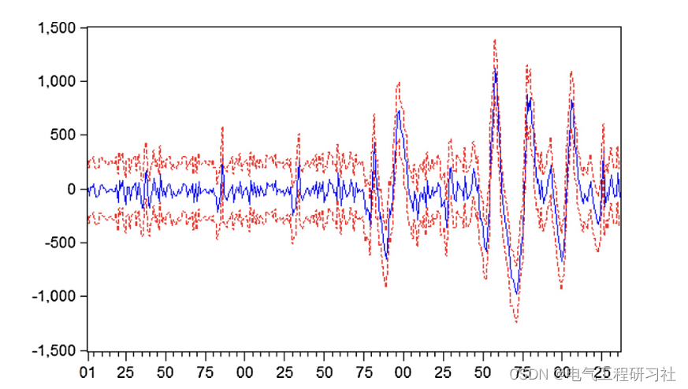
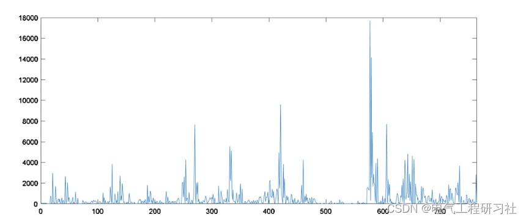
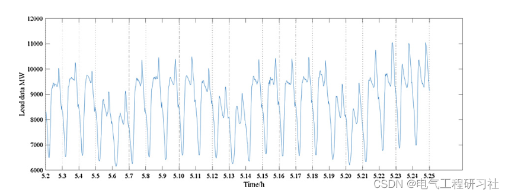
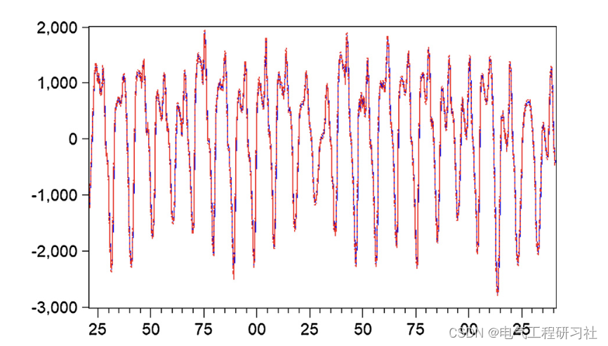
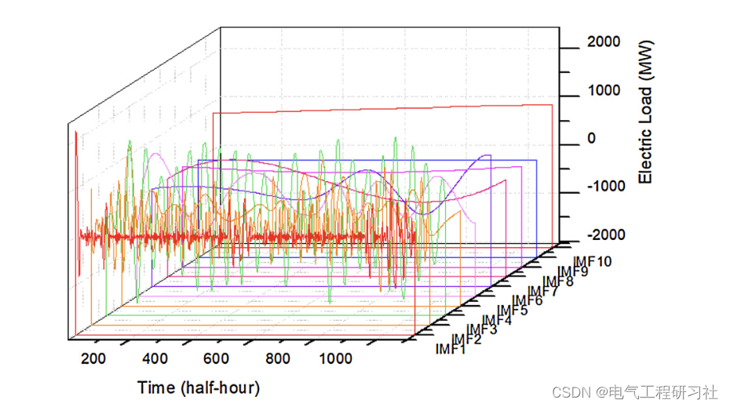
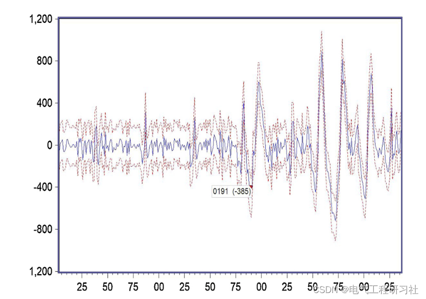
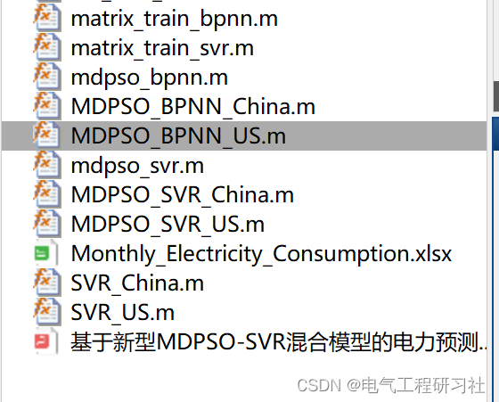
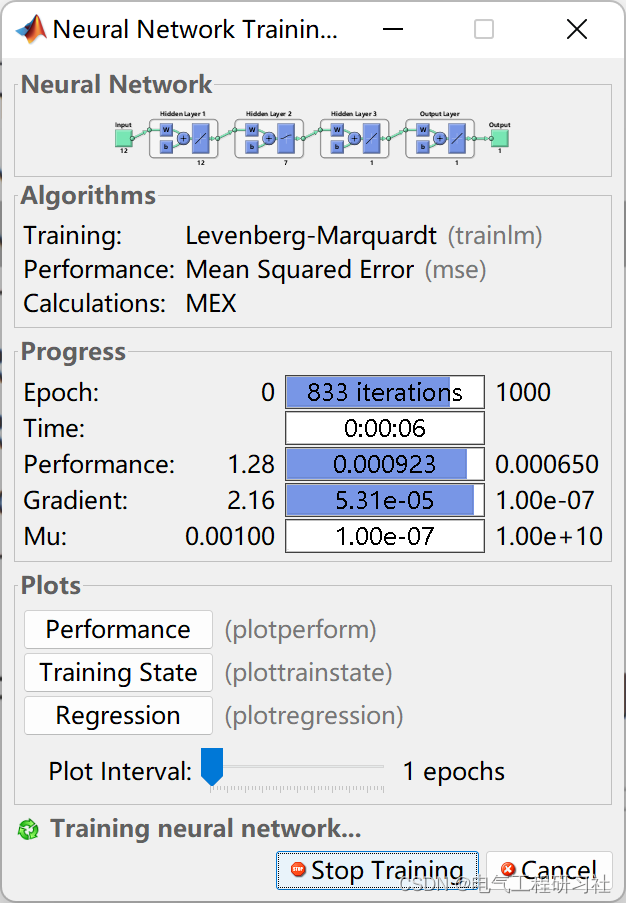

# Electric Power Forecasting | Electric Power Forecasting Feature Selection Based on the New MDPSO-SVR Mixed Model (Matlab Code Implementation)

In recent years, the development of mathematical theories and modern computing has facilitated continuous improvements in power consumption prediction models, including economic models, integrated analysis models, and classification prediction models. Economic models include econometric methods, regression analysis methods, and grey prediction methods. Integrated analysis models include the electric elasticity coefficient method, analogy method, and average growth rate method. Classification prediction models include industry-specific prediction methods, large user comprehensive analysis methods, and sub-regional prediction methods. Hybrid predictive analysis methods based on machine learning and optimization theory have achieved good results in long-term and short-term electricity consumption forecasting.
In recent years, the importance of the power industry to society and economic development has been increasing. For the sustainable operation of power industrial businesses, accurate electricity consumption prediction models can adjust the production and consumption patterns of electricity, and also support energy policy decisions such as load unit commitments, plant operation safety, and economic load dispatch. Researching the patterns of electricity production and consumption using electricity consumption data helps to determine the regulatory adjustments for the development of the electricity economy. This paper combines various machine learning methods (Empirical Mode Decomposition (EMD) method, Support Vector Regression (SVR) model, Particle Swarm Optimization (PSO) algorithm), thermodynamic reaction dynamics theory, and econometric models (AR-GARCH model), developing a new hybrid prediction model, namely EMD-SVR-PSO-AR-GARCH model, for predicting electricity consumption. It adopts a new perspective on the economic behavior of electricity use and consumption. The developed model uses electricity consumption data from the New South Wales (NSW, Australia) market for prediction. Then, complex electricity usage and consumption economic behavior are analyzed using Nash equilibrium and Porter's Five Forces model to determine the regulation and economic development of electricity, supporting the sustainable development of electricity.
This paper is based on the framework of Support Vector Regression (SVR) with feature selection, which includes four feature selection strategies: Discrete Particle Swarm Optimization (DPSO), Boolean Particle Swarm Optimization (BPSO), Genetic Algorithm (GA), and Modified Discrete Particle Swarm Optimization (MDPSO). It is used for step-by-step power forecasting. In addition, Backpropagation Neural Network model (BPNN) and MDPSO-BPNN are used for comparative analysis with SVR and MDPSO-SVR. 2 Mathematical Model
For detailed mathematical models, refer to Part 4.
3. Running Results Editing
Editor
Editor
Editor
Editor
4. Matlab code and detailed explanation of the article. This article only showcases a portion of the code, all codes can be found in:
Editor
Editor
​  

## Images

<!-- PAYMENT_BLOCK -->

## Get this dataset

- Payment link (Stripe): [Buy now](https://buy.stripe.com/3cs8yP7sY87d0vu9AB)
- Payment QR code: 

<!-- /PAYMENT_BLOCK -->
